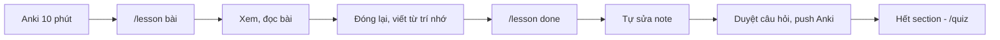

# phương pháp học

Cách học và ghi chép cho toàn bộ repo - AWS, Kubernetes, Terraform, Vault, leetcode, lý thuyết. Đọc lại trang này mỗi khi quay lại sau một thời gian nghỉ

## Nguyên Tắc

- **Không bao giờ xóa note, không học lại từ đầu.** Quên là bình thường, học lại nhanh hơn học lần đầu
- **Bạn tự viết note.** Claude chỉ hỏi, kiểm tra, tạo flashcard
- **Nhớ nhờ Anki, không nhờ đọc lại note.** Note là nơi chứa câu hỏi, Anki là nơi ôn
- **Mỗi ngày tối thiểu 10 phút Anki,** kể cả ngày không học bài mới
- **Một chủ đề chính tại một thời điểm.** Chủ đề cũ vẫn được giữ nhờ Anki

## Cấu Trúc Repo

| Đường dẫn | Là gì |
| --- | --- |
| `docs/<nhóm>/<chủ đề>/` | Note, ví dụ `docs/02-technologies/aws/` |
| `docs/<nhóm>/<chủ đề>/00-map.md` | Bản đồ chủ đề - mỗi section một dòng, trạng thái |
| `scripts/templates/note.md` | Template note |
| `.claude/skills/` | Skill `/lesson`, `/cards`, `/quiz` |
| `.rules/formatting.md` | Quy tắc cho Claude (file `CLAUDE.md` trỏ tới đây) |
| `scripts/lint.py` | Lint - chỉ kiểm tra tên file kebab-case, một H1, tối đa H3. Chạy tự động khi commit |

- Folder chủ đề và section chỉ tạo khi bắt đầu học, không tạo trước
- Note cũ không dùng nữa → chuyển vào folder `_archive/`, không xóa (site và lint bỏ qua folder bắt đầu bằng `_`)

## Nguồn Học

Mỗi chủ đề đang học có một dòng trong bảng Sources của skill `/lesson` (`.claude/skills/lesson/SKILL.md`)

| Chủ đề | Nguồn | Loại | Ở đâu |
| --- | --- | --- | --- |
| aws | Adrian Cantrill SAA-C03 | Video + phụ đề | `/Users/kyphan/Documents/courses/aws/` |

Ba loại nguồn

- Video + phụ đề `.srt` - `/lesson done` so note với phụ đề
- Docs - trang tài liệu chính thức, blog. `/lesson <URL>`, `/lesson done` so note với trang đó
- Sách - `/lesson` vẫn tạo note, `/lesson done` bỏ bước so sánh, chỉ làm thẻ

## Bức Tranh Chung

## Chuẩn Bị Một Lần

- Anki desktop + add-on AnkiConnect (code `2055492159`). Mở Anki mỗi khi push thẻ
- Trong Anki, giới hạn khoảng 15 thẻ mới mỗi ngày (Deck options → New cards/day)
- Deck tự tạo theo chủ đề - `arca::aws`, `arca::kubernetes`, ... Ôn deck cha `arca` là ôn tất cả
- Mở Claude Code tại folder `arca` - các skill chỉ có trong repo này
- Theo chủ đề
  - AWS - học bài 0011 (Creating a Budget) và làm theo trước mọi demo. Demo tạo tài nguyên thật, tốn tiền thật
  - Kubernetes - cluster local (`kind` hoặc `minikube`)
  - Terraform, Vault - cài CLI, chạy local (`vault server -dev`)

## Một Buổi Học

Khoảng 30-60 phút, 1-2 bài

### 1. Ôn Trước

- Làm hết thẻ Anki đến hạn
- Ôn trước, học mới sau - nếu hết giờ thì vẫn đã ôn

### 2. Bắt Đầu Bài

- Gõ `/lesson 264`, `/lesson dead letter`, `/lesson k8s <URL>`
- Claude tạo note trống đúng chỗ, điền sẵn tiêu đề, nguồn, ngày
- Trong chat, Claude đưa ra
  - Bài cần học trước, nếu nguồn có dặn
  - 2-3 câu hỏi để để ý khi học - đừng tra đáp án, cứ học
- Bài nhiều phần (`PART1`, `PART2`) - dùng chung một note
- Bài demo, lab - Claude không tạo note (xem mục Bài Demo)

### 3. Xem, Đọc

- Học hết bài, **không ghi chép trong lúc học**
- Nghe hoặc đọc thấy "for the exam", "important", "be careful", con số, giới hạn, mặc định → nhớ lấy, đó là Traps
- Bài dài - dừng mỗi khoảng 10 phút, tự nói lại ý chính trong đầu

### 4. Viết Từ Trí Nhớ

- Đóng lại. Viết 5-10 phút theo template (xem mục Cách Viết Note)
- Không nhớ thì để trống, đừng mở lại ngay - chỗ trống chính là chỗ cần học
- Đây là bước quan trọng nhất. Cố nhớ ra mới là lúc đang học

### 5. Kiểm Tra

- Gõ `/lesson done`
- Claude so note với nguồn, báo theo 3 nhóm
  - Sai - note nói khác nguồn
  - Thiếu, quan trọng - những gì nguồn nhấn mạnh mà note chưa có
  - Thiếu, nhỏ
- Claude **không sửa note**. Bạn tự thêm bằng lời của mình, có thể xem lại đúng đoạn đó
- Phụ đề AWS do Whisper tạo nên có lỗi nghe nhầm ("dead letter cues") - đừng lo về chính tả thuật ngữ

### 6. Tạo Flashcard

- Vẫn trong `/lesson done`, Claude kiểm tra câu hỏi theo 4 loại (xem mục Viết Câu Hỏi)
- Claude đề xuất câu hỏi còn thiếu → bạn duyệt, sửa → Claude ghi vào note
- Claude push lên Anki và cập nhật `00-map.md`
- Muốn làm riêng bước này - `/cards <note>`

### Bài Demo, Lab

- Làm theo cùng lúc với video hoặc tài liệu
- Thêm `Lab Log` 3 dòng vào note liên quan - làm gì, lỗi gì, sửa thế nào
- **Xóa tài nguyên sau khi xong**, nhất là trên AWS

## Cách Viết Note

### Template

File `scripts/templates/note.md`, 4 phần, bỏ phần nào không có gì

Đầu file là frontmatter, `/lesson` điền sẵn trừ `description`

- `title` - giống H1
- `description` - một dòng bạn tự viết sau khi học xong, trang web và AI dùng dòng này để tóm tắt note
- `sidebar_position` - thứ tự trong thư mục, giống số đầu tên file
- `tags` - chủ đề và khóa học, ví dụ `[aws, aws-saa]`

| Phần | Viết gì | Độ dài |
| --- | --- | --- |
| Problem | Không có cái này thì cái gì hỏng, cái gì khó | 1-2 dòng |
| How It Works | Cơ chế, bằng lời của mình | 3-7 bullet |
| Traps | Bẫy, giới hạn, con số, mặc định. Khóa luyện thi đặt tên `Exam Traps` | Tùy bài |
| Questions | `- Q: ... A: ...` - thành thẻ Anki | 4-8 câu |

Phần tùy chọn (danh sách nằm trong comment cuối template)

- Comparison - so sánh X và Y bằng bảng
- Flow - các bước của một quá trình
- Commands - lệnh CLI (kubectl, terraform, vault), mỗi lệnh một dòng comment
- Limits - con số, quota, mặc định
- Pricing - trả tiền cho cái gì
- When Not To Use - nhược điểm, lựa chọn khác tốt hơn
- Example - một ví dụ cụ thể
- Lab Log - 3 dòng cho bài thực hành
- Related - link tới note khác

### Quy Tắc

- Khoảng 40 dòng mỗi note. Dài hơn thường là đang chép slide hoặc tài liệu
- Tối đa 1 hình - tự vẽ hoặc Mermaid tốt hơn chụp slide
- Tiếng Việt, tiếng Anh, trộn đều được. Thuật ngữ giữ tiếng Anh
- Một file cho một chủ đề nhỏ, có thể gom 1-3 bài
- Không cần đẹp, không cần đúng format

### Ví Dụ - Chép Slide và Tự Viết

Chép slide (kiểu note AWS cũ, dễ ngán)

> Concepts - Globally resilient (multiple DNS servers) - Hosts DNS records (e.g. A, AAAA, MX, NS, TXT, ...)

Tự viết (dễ đọc lại, dễ nhớ)

> Problem - message lỗi cứ quay lại queue mãi, xử lý fail hoài

Note mẫu đầy đủ - [SQS dead-letter queues](../02-technologies/aws/13-serverless-and-application-services/sqs-dead-letter-queues.md)

### Viết Câu Hỏi

| Loại | Kiểm tra gì | Ví dụ |
| --- | --- | --- |
| Fundamental | Vì sao có nó, chạy từng bước thế nào | "Walk through what happens to a message that always fails" |
| Scenario | Chọn đúng công cụ cho nhu cầu - kiểu đề thi | "5 source queues, one place to inspect failures. How many DLQs?" |
| Interview | Giải thích, so sánh, trade-off, debug | "Why use a DLQ instead of retrying forever?" |
| Traps | Con số, giới hạn, mặc định | "1 day in source, DLQ retention 2 days. How long in DLQ?" |

- Mỗi note ít nhất 1-2 câu Fundamental
- Một thẻ một ý. Trả lời được trong 10 giây
- Không hỏi câu yes/no, không hỏi đường click trên giao diện

## Theo Loại Chủ Đề

| Loại | Ví dụ | Nguồn chính | Câu hỏi ưu tiên sau Fundamental | Ghi chú |
| --- | --- | --- | --- | --- |
| Khóa luyện thi | AWS SAA | Video | Scenario, Traps | Gần thi làm practice exam |
| Công cụ | Kubernetes, Terraform, Vault, Docker, Linux | Docs + lab | Interview, Traps | Lab quan trọng hơn thẻ |
| Lý thuyết | Game theory, security foundations | Sách, khóa học | Fundamental, Interview | Thêm phần Example |
| Bài tập | Leetcode | Danh sách bài | - | Ghi mẹo nhận dạng vào cột `Note` |

### Công Cụ - Kubernetes, Terraform, Vault

- Chứng chỉ CKA, CKAD là thi thực hành trên terminal - luyện lab là chính, thẻ chỉ để nhớ khái niệm và flag hay quên
- Terraform Associate, Vault Associate là trắc nghiệm - giống AWS, Scenario và Traps quan trọng
- Phần `Commands` - chỉ ghi lệnh hay dùng, kèm một dòng giải thích nó làm gì bên dưới
- Thẻ về lệnh - hỏi mục đích, không hỏi thuộc lòng. Ví dụ "Xem vì sao pod bị Pending - lệnh nào?"
- Mỗi lab - `Lab Log` 3 dòng. Lỗi gặp khi làm lab là câu Interview rất tốt

### Leetcode

Leetcode học bằng cách làm bài, không phải xem bài giảng, nên không dùng `/lesson`. Mỗi pattern một file (`06-sliding-window.md`), mỗi bài một dòng trong bảng

File của pattern chưa học có `draft: true` trong frontmatter - vẫn thấy khi chạy `npm run dev`, nhưng không lên web. Khi bắt đầu pattern đó, xóa dòng `draft: true`

Một bài

1. Đọc đề, tự đoán pattern trước khi code
2. Tự giải tối đa khoảng 25 phút
3. Bí thì đọc lời giải, hiểu, rồi đóng lại và tự code lại từ đầu
4. Ghi 1-2 dòng vào cột `Note` - mẹo nhận dạng, không chép lời giải
   - Ví dụ "substring dài nhất + điều kiện → sliding window, co trái khi vi phạm"
   - Phải đọc lời giải thì thêm `(redo)` vào cuối
5. `/cards <file>` - mỗi ô `Note` có nội dung thành thẻ "bài này dùng pattern gì, vì sao?"

Ôn

- Anki nhắc pattern hằng ngày
- Bài có `(redo)` - giải lại sau khoảng 3 ngày và 1 tuần, giải được thì xóa `(redo)`
- Hiểu pattern chung (khi nào dùng, template code) - ghi ở phần đầu file, trên bảng, theo template note bình thường

## Section Và Map

- `00-map.md` trong mỗi chủ đề - mỗi section một dòng, trạng thái `todo` / `doing` / `done`
- Bắt đầu section mới
  - Thêm dòng `doing` vào map, nói tên section với `/lesson` một lần
  - Folder tên theo section, ví dụ `13-serverless-and-application-services`, chỉ tạo khi bắt đầu
- Hết section
  - `/quiz <folder section>` - xem yếu loại câu hỏi nào
  - Đổi trạng thái thành `done`
- AWS - folder video không chia section. Các bài `update_ch_...` ở cuối (0383-0385) thuộc section cũ, học khi tới chủ đề đó

## Ôn Tập

| Khi nào | Làm gì | Thời gian |
| --- | --- | --- |
| Mỗi ngày | Anki deck `arca` | 10-15 phút |
| Ngày bận, lười | Chỉ Anki, không học mới | 10 phút |
| Cuối tuần | `/quiz` (không tham số) - các note mới đổi | 15 phút |
| Hết section | `/quiz <folder>` | 20 phút |
| Thỉnh thoảng | `/quiz <folder> interview` - phỏng vấn thử | 20 phút |
| Gần thi | Practice exam, sai câu nào thì thêm vào Questions | - |

## Khi Bị Gián Đoạn

Nghỉ hơn 2 tuần, thấy quên hết

1. Không xóa, không học lại từ đầu
2. Gõ `/quiz comeback <chủ đề>`, ví dụ `/quiz comeback aws`
3. Làm hết thẻ Anki tồn (tối đa 100 thẻ một ngày nếu nhiều)
4. Claude quiz 2 section gần nhất, chỉ ra note và bài cần xem lại
5. Chỉ xem lại những bài đó, rồi học tiếp bài mới như bình thường

## Thêm Chủ Đề Mới

Ví dụ bắt đầu Kubernetes sau AWS

1. Chọn một nguồn chính - một khóa học, hoặc docs chính thức theo một thứ tự
2. Nói với Claude "bắt đầu học Kubernetes từ ..." - Claude thêm một dòng vào bảng Sources của `/lesson` và bảng Nguồn Học ở trang này
3. Tạo folder `docs/02-technologies/kubernetes/` và `00-map.md` khi học bài đầu tiên
4. Học như bình thường với `/lesson`. Deck `arca::kubernetes` tự tạo
5. Nếu chủ đề cũ chưa xong - để nó `doing` trong map, vẫn ôn bằng Anki, không xóa

## Các Skill

| Skill | Khi nào | Làm gì | Không làm gì |
| --- | --- | --- | --- |
| `/lesson [chủ đề] <bài>` | Bắt đầu bài | Tạo note trống, câu hỏi để để ý, bài cần học trước | Không ghi nội dung bài vào note |
| `/lesson done` | Viết xong note | So với nguồn, báo sai và thiếu, chạy `/cards`, cập nhật map | Không sửa note |
| `/cards <note hoặc folder>` | Muốn tạo thẻ riêng | Kiểm tra 4 loại câu hỏi, đề xuất, push Anki | Không thêm kiến thức ngoài note nếu bạn không đồng ý |
| `/quiz [note, folder]` | Cuối tuần, hết section | Hỏi từng câu, chấm theo loại, ghi câu sai vào note | Không đưa đáp án trước khi bạn trả lời |
| `/quiz interview` | Luyện phỏng vấn | Câu mở, có câu hỏi nối tiếp, đáp án mẫu | - |
| `/quiz comeback <chủ đề>` | Sau khi nghỉ | Quy trình quay lại | Không bảo bạn học lại từ đầu |

## Không Làm

- Xóa note hoặc folder rồi bắt đầu lại
- Nhờ AI viết hoặc tóm tắt bài thay mình
- Ghi chép trong lúc học, chụp slide
- Tạo trước folder cho cả khóa
- Học song song nhiều chủ đề mới
- Bỏ Anki nhiều ngày liền

## Nhịp Độ

- AWS - khoảng 385 bài. 10 bài một tuần → khoảng 9 tháng. Bài demo nhanh hơn vì không cần note
- Chậm mà đều tốt hơn nhanh rồi bỏ - 2 bài một ngày, 5 ngày một tuần là đủ

## Bảo Trì Trang Này

- Trang này viết bằng tiếng Việt
- Mỗi khi sửa `.rules/`, `.claude/skills/` hoặc `scripts/templates/`, Claude cập nhật trang này trong cùng lần sửa
