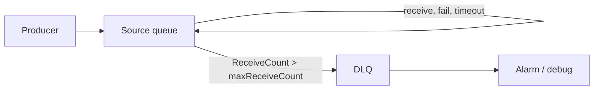

# sqs dead-letter queues

> Cantrill 0264 · 2026-10-26

## Problem

A bad message fails every time. It comes back after each visibility timeout, forever. It wastes processing and hides real errors

## How It Works

- Each receive → the message's `ReceiveCount` goes up by 1
- Redrive policy on the source queue - which DLQ to use + `maxReceiveCount`
- `ReceiveCount` > `maxReceiveCount` and the message was not deleted → move it to the DLQ
- DLQ = a normal SQS queue, used for
  - Alarm when anything lands in it
  - Look at failed messages and logs in isolation
  - Separate processing for problem messages
- One DLQ can serve many source queues

## Exam Traps

- Enqueue timestamp is kept when a message moves to the DLQ
  - 1 day in source + DLQ retention 2 days → only 1 more day in DLQ
  - So DLQ retention should be longer than source queue retention

## Questions

- Q: Walk through what happens to a message that always fails, from first receive to the DLQ A: Received → hidden for visibility timeout → not deleted → back in queue, `ReceiveCount` +1 → repeat until > `maxReceiveCount` → moved to DLQ
- Q: A message keeps failing and coming back to the queue. How do you stop the loop? A: Redrive policy with `maxReceiveCount` → message moves to a DLQ
- Q: When exactly does SQS move a message to the DLQ? A: `ReceiveCount` > `maxReceiveCount` and it was not deleted
- Q: Why should DLQ retention be longer than the source queue's? A: Enqueue timestamp is not reset on move, age counts from the source queue
- Q: Message spent 1 day in source, DLQ retention is 2 days. How long can it stay in the DLQ? A: 1 more day
- Q: You want to know right away when processing starts failing. What do you set up? A: Alarm on messages arriving in the DLQ
- Q: 5 source queues, you want one place to inspect all failed messages. Minimum number of DLQs? A: 1 - one DLQ can serve many source queues
- Q: Interviewer asks "Why use a DLQ instead of just retrying forever?" - 3 benefits? A: Alarm on failures, debug bad messages in isolation, separate processing for them
