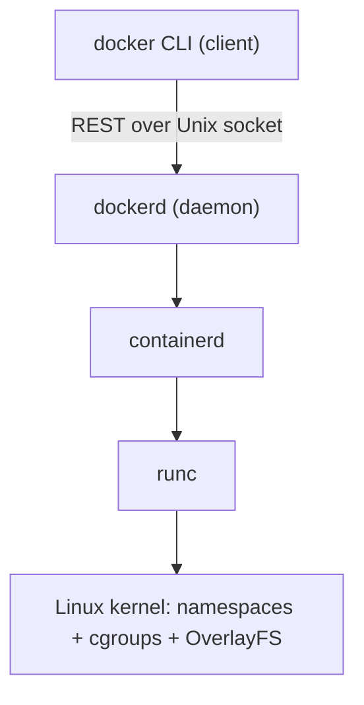
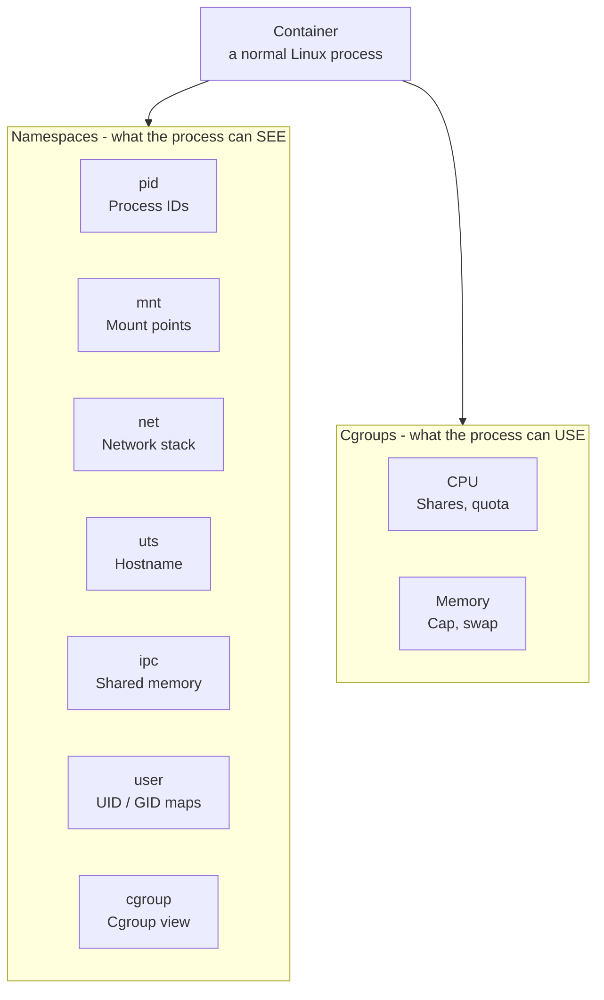

# fundamentals

## Core Architecture & Containers

### Docker Daemon & Runtime

- dockerd: Long-running background process
- containerd: Lower-level runtime
- runc: Executes syscalls

### Container Isolation

## Alpine Linux Images

### Overview & Philosophy

- Alpine image: Built on Alpine Linux instead of heavy distributions like Ubuntu or Debian
- Philosophy: Only includes files strictly necessary to run the process
- Base size: Approximately 5 MB

### Key Features

- BusyBox: Combines common UNIX utilities into a single optimized executable file
- musl libc: Replaces glibc as interface to the Linux kernel
- Characteristics: Lightweight, fast, designed for embedded systems and minimal environments

## Related

- [commands](./03-commands.md) - daily commands, container rules, restart policies
