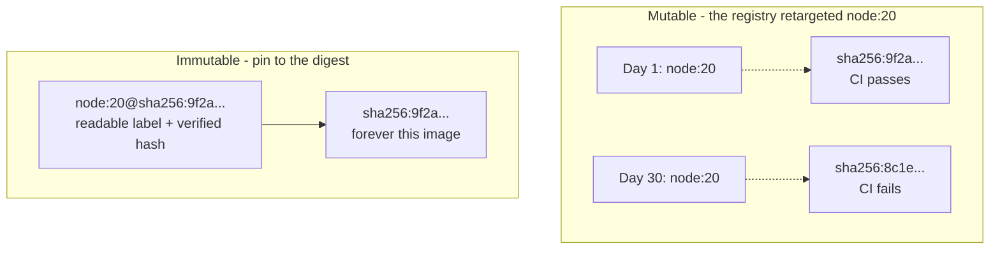
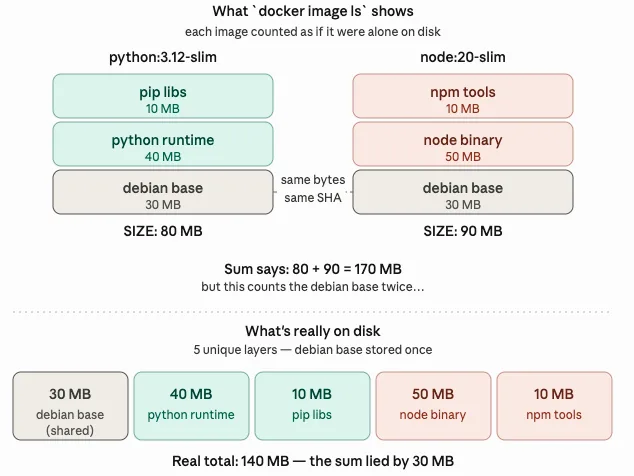

# image storage

## Tags vs Digests

- Tag: Mutable reference pointing to a manifest digest
- Digest: Immutable SHA256 hash of the manifest, changes only if content changes



## Disk Usage Measurement



- `docker image ls`: Shows virtual size by summing all layers, ignoring sharing
- `docker system df`: Shows actual disk usage, accounting for layer sharing

## Image Removal (docker rmi)

- Rule: `docker rmi` removes the manifest, layers are deleted only when unreferenced

```markdown
python rt     40 MB   → only python used it      → DELETED   (-40 MB)
pip libs      10 MB   → only python used it      → DELETED   (-10 MB)
debian base   30 MB   → node still uses it       → KEPT      ( 0 MB)
                                                  ─────────
                                       Disk freed:    50 MB
```

- Shared layers: Deleting an image only frees disk space for unshared layers

## Image Best Practices

- Pin by digest: Use immutable references like `node:20-slim@sha256:9f2a3b…`
- Disk measurement: Use `docker system df` for actual usage, not `docker image ls`
- Disk cleanup: Use `docker image prune` or `docker system prune` to free space

## Related

- [images](./02-images.md) - layers and OverlayFS that this page measures
